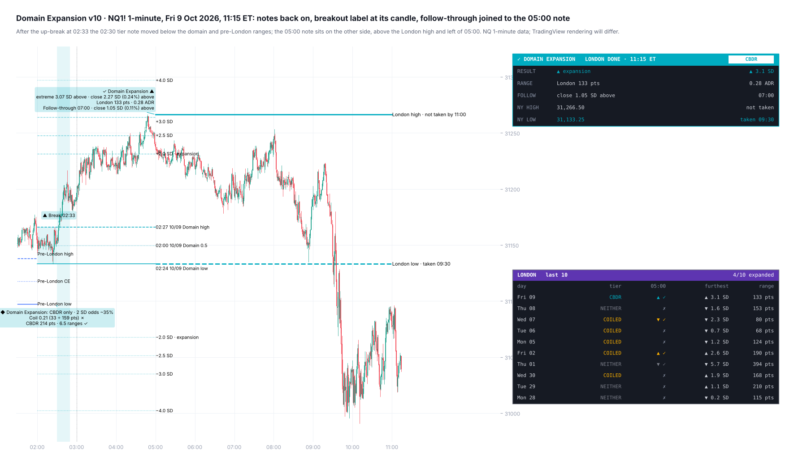
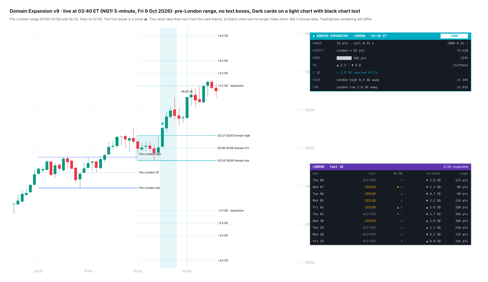

# Domain Expansion

**The London expansion model (domain range, overnight ATR and CBDR qualifier) with a London card**

TradingView indicator, Pine Script v6. Open source under the Mozilla Public License 2.0.

*Mock-up of how it looks on the chart.*

**Domain Expansion** is Model 1: the London expansion. The London opening range (the *domain*, 02:00–02:30 ET) is graded at 02:30. Its break is then tracked through London and carried into New York.

## What it draws

- **The domain range** (02:00–02:30): its high, low, midpoint and optional shading.
- **The qualifier at 02:30.** The tier comes from:
  - **coiled:** the domain range ÷ the overnight ATR (18:00–02:30) is small;
  - **volatile:** the overnight ATR is large against price;
  - **CBDR wide:** the 14:00–20:00 range is wide.
  The tier is Both / Coiled-or-volatile only / CBDR only / Neither. Every drawing can take the tier's colour.
- **The execution window** (02:30–02:50) and the first break in it, labelled at its candle (e.g. "▲ Break 02:33").
- **SD extensions** in domain-range multiples (1.0, 1.5, 2.0, 2.5, 3.0, 4.0, 5.0 and custom), and the expansion line.
- **The pre-London dealing range** (00:00–00:59): high, low and CE, drawn to 02:00 or 05:00.
- **The London high / low,** carried to 11:00 ET and marked when taken, or "not taken by 11:00".
- **Two text notes a day:** the tier at 02:30, and the 05:00 result with the follow-through (07:00).

## London card

Live from 02:30:
- the domain range and today's tier;
- the expected London range (02:00–04:59), its middle half, and how much of it is done;
- the furthest SD past the range so far;
- the live odds of 2 SD by 04:59;
- how often the London high and low were already in at this time, given price's distance from them.

After 05:00:
- the result;
- the London range against ADR20;
- the follow-through close (07:00);
- whether New York has taken the London high and low.

A second table lists the last 10 London sessions (3–30): tier, result at 05:00, furthest SD and range.

## What the tests showed

NQ, ES and RTY 1-minute data 2018–26: 6,135 London sessions, and 5,526 for the pre-London range. Each held in 2018–24 and 2025–26 and on each symbol.

- **NY AM** took the London high on 66% of sessions and the low on 62%. By 11:00: 75% and 71%.
- **London took the pre-London range's** high on 78% of sessions and its low on 73%:
  - at least one: 99.7%;
  - both: 52%.
- **London traded through the pre-London CE** on 75% of sessions, and on 64% when price sat outside the range at 02:00.
- **The expected range** was fitted on 2018–24 and checked on 2025–26: 48% of sessions landed inside the middle half (R² 0.87).
- Odds are shown only at the default settings they were measured on.

## Alerts

One alert on "Any alert() function call" covers all of these; each can be switched off:
- domain range set, with the tier;
- first break in the execution window;
- expansion line reached;
- the 05:00 result;
- London high or low taken before 11:00.

## Settings

**View** sits at the top:
- card theme;
- text size;
- chart text colour;
- label date format;
- days to keep;
- how older days fade.

The asset setting (NQ by default, or a custom scale) sets the thresholds for other markets.

## Credits

- Concepts: ICT (Michael J. Huddleston), including the CBDR and the London open.
- Written from scratch.

*Historical frequencies, not guarantees.*

## Add it to TradingView

1. In TradingView, open the **Pine Editor** (bottom panel).
2. Copy the contents of `Domain_Expansion_Indicator.pine` into a new script.
3. **Save**, then **Add to chart**.

## More screenshots

## License

Mozilla Public License 2.0, see [LICENSE](LICENSE). © Unclehk2000.

*Historical frequencies, not guarantees. Nothing here is financial advice.*
