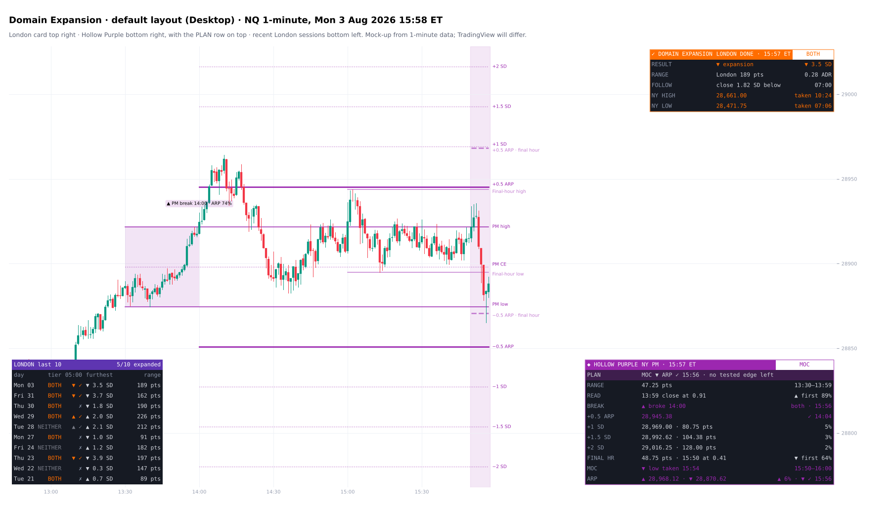
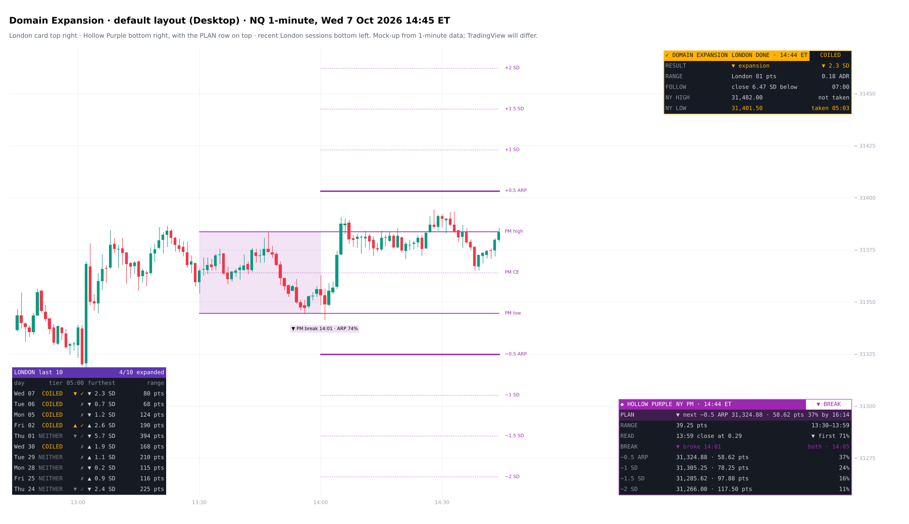
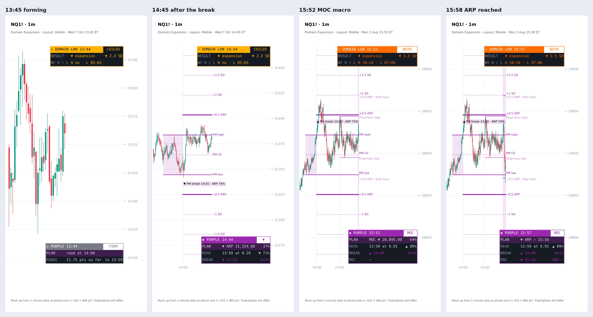

# Domain Expansion

**The London expansion model (domain range, overnight ATR and CBDR qualifier) with a London card, and Hollow Purple: the NY PM model (13:30 PM range, its ARP and SDs, the final hour and the market-on-close macro)**

TradingView indicator, Pine Script v6. Open source under the Mozilla Public License 2.0.

*Mock-up of how it looks on the chart.*

**Domain Expansion** is Model 1: the London expansion. The London opening range (the *domain*, 02:00–02:30 ET) is graded at 02:30. Its break is then tracked through London and carried into New York.

## What it draws

- **The domain range** (02:00–02:30): its high, low, midpoint and optional shading.
- **The qualifier at 02:30.** The tier comes from:
  - **coiled:** the domain range ÷ the overnight ATR (18:00–02:30) is small;
  - **volatile:** the overnight ATR is large against price;
  - **CBDR wide:** the 14:00–20:00 range is wide.
  The tier is Both / Coiled-or-volatile only / CBDR only / Neither. Every drawing can take the tier's colour.
- **The execution window** (02:30–02:50) and the first break in it, labelled at its candle (e.g. "▲ Break 02:33").
- **SD extensions** in domain-range multiples (1.0, 1.5, 2.0, 2.5, 3.0, 4.0, 5.0 and custom), and the expansion line.
- **The pre-London dealing range** (00:00–00:59): high, low and CE, drawn to 02:00 or 05:00.
- **The London high / low,** carried to 11:00 ET and marked when taken, or "not taken by 11:00".
- **Two text notes a day:** the tier at 02:30, and the 05:00 result with the follow-through (07:00).

## London card

Live from 02:30:
- the domain range and today's tier;
- the expected London range (02:00–04:59), its middle half, and how much of it is done;
- the furthest SD past the range so far;
- the live odds of 2 SD by 04:59;
- how often the London high and low were already in at this time, given price's distance from them.

After 05:00:
- the result;
- the London range against ADR20;
- the follow-through close (07:00);
- whether New York has taken the London high and low.

A second table lists the last 10 London sessions (3–30): tier, result at 05:00, furthest SD and range.

## Hollow Purple · NY PM

The New York afternoon, built from ICT's Price Action Chronicles on the market-on-close (MOC) macro and tested on 6,333 NQ, ES and RTY sessions (2018–26). It needs a chart of 5 minutes or less for the final hour.

**What it draws**
- **The PM range** (13:30–13:59), shaded, with its high, low and CE. ICT's NY PM session opens with the 13:30 pre-market, and its first 30 minutes play the part 09:30–10:00 plays in the morning.
- **The read at 14:00**: where the 13:59 close sits in the PM range, as a note with the odds of which side breaks first.
- **The −0.5 ARP** (algorithmic range projection: half the range beyond the high or low) and **1, 1.5 and 2 SD**, on both sides from 14:00 to 16:14. They dash once traded.
- **The first break** after 14:00, labelled at its candle.
- **The final-hour range** (15:00–15:49), drawn as it forms and set at 15:50, then **its −0.5 ARP** above and below to 16:14.
- **The MOC macro** (15:50–16:00), shaded.

**Hollow Purple card** (13:30 → 17:00)

The top row, **PLAN**, says what to watch now: the level, its distance in points and the odds.
- 13:30–13:59: the PM range is forming; it is read at 14:00.
- Before the first break: the side the read favours, its edge and how far away it is (e.g. "Wait for the break · ▲ PM high 31,376.00 · 4.00 pts", ▲ 79%).
- After the break: the next level on that side not yet reached (−0.5 ARP, then 1, 1.5, 2 SD) with the live odds by 16:14.
- 15:40–15:49: the MOC macro is next (it takes a final-hour side 72% of the time).
- From 15:50: the final-hour side the MOC is likely to take first, then that side's ARP. Once the ARP is in, there is no tested edge left for the day.
- After 16:14: the day's summary.

Below it:
- RANGE: the PM range in points and against ADR20.
- READ: the 13:59 close's place and the odds of the first break.
- BREAK: the first break, and whether it held.
- The −0.5 ARP and 1 / 1.5 / 2 SD on the break side (before a break, on the side the read favours): the price and distance, then ✓ with the time or the live odds by 16:14.
- FINAL HR: the final-hour range, where 15:50 opened in it, and the odds of which side the MOC takes first.
- MOC: which final-hour side it took.
- ARP: both final-hour ARPs with ✓ or the live odds.

**What the tests showed** (each held in 2018–24 and 2025–26 and on each symbol)
- **The 13:59 close sets which side breaks first.** % up first by octant, bottom to top: 12 · 19 · 29 · 44 · 55 · 67 · 79 · 89. The range was broken by 16:14 on 99.5% of sessions; the first break held (the other side untouched) on 52%.
- **On the first-break side by 16:14:** −0.5 ARP 74%, 1 SD 51%, 1.5 SD 35%, 2 SD 23% (2025–26: 69 · 45 · 30 · 18).
- **The MOC macro** (15:50–15:59) took one side of the final-hour range on 72% of sessions (to 16:14: 80%), and the side nearer price first (Brier 0.250 → 0.146 on 2025–26). It reached the final-hour −0.5 ARP on 16% (to 16:14: 27%).
- **Live odds:** a level not yet traded since 13:30 trades by 16:14 with odds from its distance in ATR15 (the 15-minute ATR at 13:30) and the time left. Fit on 2018–24, scored on 2025–26: Brier 0.116 → 0.092. In 2025–26 levels traded up to 8 points less often than predicted, so read them as slightly generous.

**Tested and not found**
- The −0.5 ARP is not a terminus: MOC runs stopped there no more often than at −0.375 or −0.625.
- MOC lows and highs did not land on the day's octant, 16th or quadrant more than on a shifted grid. They were reached (61 / 49 / 40% when price sat inside them at 15:50), but they are not turning points.
- The midpoint between an old high and the ARP (ICT's ES example) was not a stopping point either.
- Long in the tooth: the MOC's direction was 50 / 50 against the day's trend (2025–26 alone leaned counter-trend; 2018–24 did not).
- Smooth equal highs or lows were taken *less* often than the jagged side (−5 points).
- The PM continued the AM's direction 51.6% of the time (no edge). The lunch range (11:30–13:29) broke first in the AM's direction 53% (small, but it held).

## What the tests showed

NQ, ES and RTY 1-minute data 2018–26: 6,135 London sessions, and 5,526 for the pre-London range. Each held in 2018–24 and 2025–26 and on each symbol.

- **NY AM** took the London high on 66% of sessions and the low on 62%. By 11:00: 75% and 71%.
- **London took the pre-London range's** high on 78% of sessions and its low on 73%:
  - at least one: 99.7%;
  - both: 52%.
- **London traded through the pre-London CE** on 75% of sessions, and on 64% when price sat outside the range at 02:00.
- **The expected range** was fitted on 2018–24 and checked on 2025–26: 48% of sessions landed inside the middle half (R² 0.87).
- Odds are shown only at the default settings they were measured on.

## Alerts

One alert on "Any alert() function call" covers all of these; each can be switched off:
- domain range set, with the tier;
- first break in the execution window;
- expansion line reached;
- the 05:00 result;
- London high or low taken before 11:00;
- Hollow Purple: the PM range set (14:00) with the read, its first break, the ARP or an SD reached on the break side, the final-hour range set (15:50) and its ARP reached.

## Layout

The default places keep the three tables apart: the London card top right, Hollow Purple bottom right, recent London sessions bottom left.

**Layout: Mobile** (View settings) folds the cards for a phone:
- London: RESULT and NY H / L after 05:00; RANGE, 2 SD and HI / LO while London is live.
- Hollow Purple: PLAN, READ, BREAK and MOC.
- The recent-sessions table is hidden.

Every row keeps its explanation in the tooltip. Chart layouts sync across devices, so keep a separate chart layout for the phone.

## Settings

**View** sits at the top:
- layout (Desktop or Mobile);
- card theme;
- text size;
- chart text colour;
- label date format;
- days to keep;
- how older days fade.

The asset setting (NQ by default, or a custom scale) sets the thresholds for other markets.

## Credits

- Concepts: ICT (Michael J. Huddleston), including the CBDR, the London open, the NY PM pre-market, the final-hour dealing range, the algorithmic range projection and the market-on-close macro (Price Action Chronicles, Aug 2026).
- Written from scratch.

*Historical frequencies, not guarantees.*

## Add it to TradingView

1. In TradingView, open the **Pine Editor** (bottom panel).
2. Copy the contents of `Domain_Expansion_Indicator.pine` into a new script.
3. **Save**, then **Add to chart**.

## More screenshots

## License

Mozilla Public License 2.0, see [LICENSE](LICENSE). © Unclehk2000.

*Historical frequencies, not guarantees. Nothing here is financial advice.*
